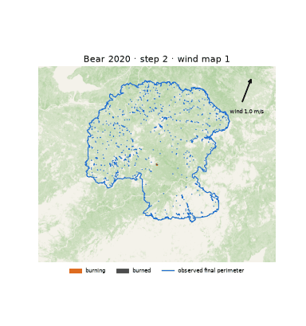
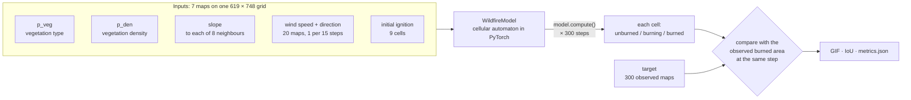
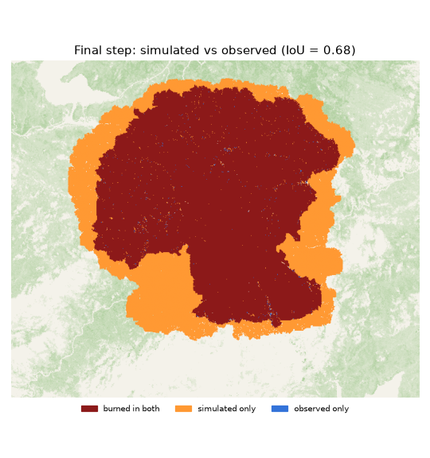
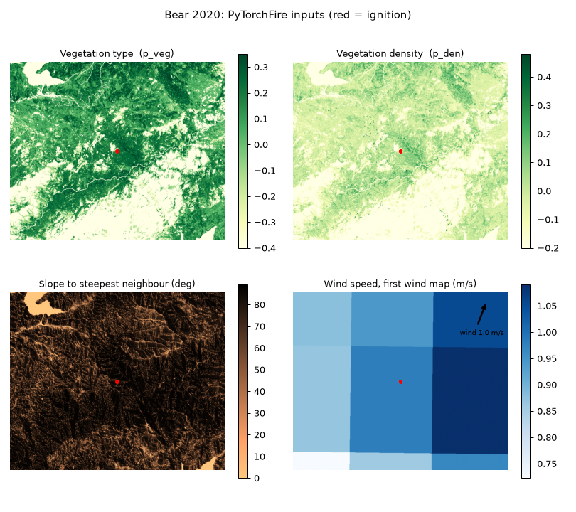

# wildfire-simulator-study



*PyTorchFire simulating the Bear 2020 fire (California) on a 619 × 748 grid.*

This repo is a small exploration of [PyTorchFire](https://github.com/xiazeyu/PyTorchFire)
(Xia & Cheng, 2025). I just installed it, ran it on the real-fire example that ships
with their repo, and compared the simulated spread with the observed one.

## The pipeline



**The spread rule** (Alexandridis et al., 2008). At each step, every burning
cell can ignite each of its 8 neighbours with probability

```
p = p_h · (1 + p_veg) · (1 + p_den) · p_wind · p_slope
p_wind  = exp(c_1 · V) · exp(c_2 · V · (cos θ − 1))   # stronger wind, and downwind, spreads more
p_slope = exp(a · slope)                               # uphill spreads more
```

and a burning cell keeps burning with probability `p_continue`. PyTorchFire
computes this for the whole grid at once as tensor operations, and keeps it
differentiable, so `a, p_h, c_1, c_2` can be fitted to an observed fire by
gradient descent. Here I only run the forward simulation, with the
**uncalibrated** starting values from the authors' example script
(`a=0.1, p_h=0.4, c_1=0.05, c_2=0.05, p_continue=0.3`, seed 0).

## Results

| | |
|---|---|
| Grid | 619 × 748 cells |
| Steps | 300 (one per observed map) |
| Runtime (MacBook CPU) | TODO s (TODO ms / step) |
| Final IoU, simulated vs observed | **TODO** |
| Final area, simulated / observed | TODO × |

 

IoU (intersection over union) = cells burned in both ÷ cells burned in either;
1 is a perfect match. since I used uncalibrated parameters, the simulated fire spread
too much, which is exactly what calibration is meant to fix.

## What I learned

1. PyTorchFire is a probabilistic cellular automaton written as tensor operations: a whole 300-step real fire runs in seconds
2. The simulator only needs a few aligned maps; the hard part for a new fire is building those maps (weather, terrain, fuel on one grid), which is what FireDataForge automates


## References

- Xia, Z. & Cheng, S. (2025). PyTorchFire: A GPU-accelerated wildfire simulator with Differentiable Cellular Automata. *Environmental Modelling & Software*, 188, 106401. [doi:10.1016/j.envsoft.2025.106401](https://doi.org/10.1016/j.envsoft.2025.106401)
- Xia, Z., Chen, L., Liu, Y. & Huang, H. (2026). FireDataForge: A Unified Framework for Multi-Source Wildfire Data Retrieval and Integration. *IEEE IRI 2026*, 528–531. [doi:10.1109/IRI69576.2026.00103](https://doi.org/10.1109/IRI69576.2026.00103)
- Alexandridis, A. et al. (2008). A cellular automata model for forest fire spread prediction: The case of the wildfire that swept through Spetses Island in 1990. *Applied Mathematics and Computation*, 204(1), 191–201. [doi:10.1016/j.amc.2008.06.046](https://doi.org/10.1016/j.amc.2008.06.046)
